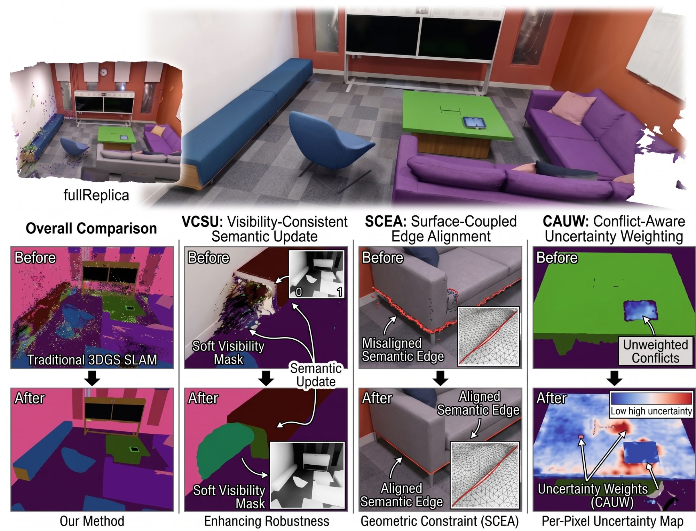
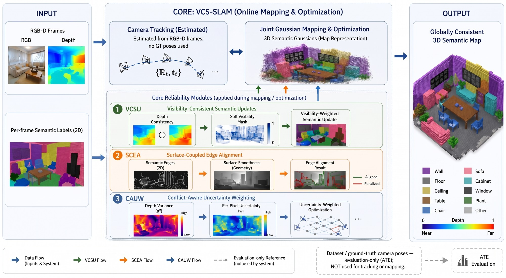
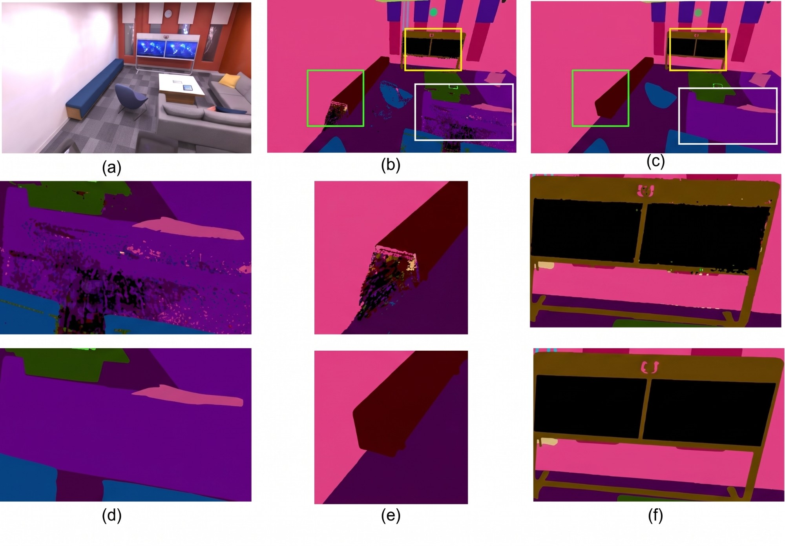

<h1 align="center">VCS-SLAM: Visibility-Consistent Semantic Fusion for 3D Gaussian SLAM</h1>

<p align="center">
  Raman Jha<sup>1,2,4</sup>, Shuaihang Yuan<sup>2,3,4</sup>, Yi Fang<sup>1,2,3,4</sup><br>
  <sup>1</sup>New York University, Electrical &amp; Computer Engineering Dept., Brooklyn, NY, USA<br>
  <sup>2</sup>Embodied AI and Robotics (AIR) Lab, NYU Abu Dhabi, UAE<br>
  <sup>3</sup>NYUAD Center for Artificial Intelligence and Robotics (CAIR), Abu Dhabi, UAE<br>
  <sup>4</sup>New York University Abu Dhabi, Electrical Engineering, Abu Dhabi, UAE
</p>

<p align="center"><b>IEEE Robotics and Automation Letters (RA-L), 2026</b> &nbsp;|&nbsp; <a href="https://arxiv.org/abs/2606.29494">arXiv</a></p>

<p align="center"></p>

## Abstract

Semantic 3D Gaussian SLAM commonly fuses 2D semantic priors into a persistent 3D map using uniform optimization weights. However, such priors are not equally reliable in online mapping: occlusions, unsupported semantic boundaries, and ambiguous ray geometry introduce persistent semantic artifacts into the global Gaussian map. We propose VCS-SLAM, a geometry-validated semantic evidence fusion framework for RGB-D 3D Gaussian SLAM. Instead of treating all semantic observations as uniformly valid supervision, VCS-SLAM evaluates their geometric reliability through visibility consistency, surface-supported boundary evidence, and ray-level conflict uncertainty. The resulting reliability-aware objective suppresses occluded semantic updates, reduces unsupported semantic bleeding, and delays premature label assignment in ambiguous regions. Experiments on Replica show improved semantic consistency, boundary preservation, and reconstruction quality, while ScanNet results confirm competitive tracking under real RGB-D input. Under structured corruption of the 2D priors, VCS-SLAM degrades at little more than half the rate of a comparable semantic Gaussian SLAM baseline and outperforms naive gating, smoothness, and entropy-weighting variants of its own modules, indicating that the gains follow from the specific formulation rather than from reweighting alone.

## Method

<p align="center"></p>

Every Gaussian carries a C-dimensional semantic logit vector that is alpha-composited into a semantic map S<sub>p</sub> and supervised with per-pixel cross-entropy. Instead of weighting all 2D labels equally, VCS-SLAM scores each pixel's reliability from the rendered geometry, ρ<sub>p</sub> = M<sub>vis</sub>(p) · C<sub>p</sub> (Eq. 3), using three modules:

| Module | What it does | Paper | Code |
|---|---|---|---|
| **VCSU** visibility-consistent semantic updates | Soft mask M<sub>vis</sub> = exp(-\|D<sub>p</sub> - D<sub>p</sub><sup>obs</sup>\|² / 2σ<sub>vis</sub>²) down-weights labels where rendered and sensor depth disagree | Eq. 5 | `visibility_mask` |
| **CAUW** conflict-aware uncertainty weighting | Per-pixel confidence C<sub>p</sub> = 1 / (1 + γ V<sub>pix</sub>) from the ray depth variance V<sub>pix</sub> = E[D²] - E[D]² | Eqs. 9-10 | `conflict_confidence` |
| **SCEA** surface-coupled edge alignment | Penalises semantic edges that lack a depth edge, L<sub>edge</sub> = mean(E<sub>S</sub> · max(0, τ<sub>d</sub> - Ê<sub>D</sub>)) | Eqs. 6-8 | `edge_alignment_loss` |

They are combined in the semantic objective L<sub>sem</sub><sup>ours</sup> = β·mean(ρ·CE) + (1-β)·mean(CE) + λ<sub>edge</sub>·L<sub>edge</sub> (Eqs. 11-12), which enters the mapping loss λ<sub>D</sub>L<sub>D</sub> + λ<sub>C</sub>L<sub>C</sub> + λ<sub>S</sub>L<sub>sem</sub><sup>ours</sup> (Eq. 13). Everything is in [`vcs_slam/reliability.py`](vcs_slam/reliability.py); the logit field is in [`vcs_slam/semantics.py`](vcs_slam/semantics.py). The SLAM backbone (tracking, mapping, densification, keyframes) follows [SplaTAM](https://github.com/spla-tam/SplaTAM) and [SGS-SLAM](https://github.com/ShuhongLL/SGS-SLAM).

Settings of the paper (Sec. IV-A4), as used by [`configs/replica/slam.py`](configs/replica/slam.py) and [`configs/scannet/slam.py`](configs/scannet/slam.py):

| σ<sub>vis</sub> | β | γ | λ<sub>edge</sub> | τ<sub>d</sub> | λ<sub>C</sub>, λ<sub>D</sub> (tracking and mapping) | λ<sub>S</sub> | mapping and densification |
|---|---|---|---|---|---|---|---|
| 0.05 | 0.7 | 100 | 0.02 | 0.75 | 0.5, 1.0 | 0.01 | every N = 8 frames |

Tracking uses RGB-D only. Details the paper leaves open are listed under [Implementation notes](#implementation-notes).

<p align="center"></p>
<p align="center"><em>Fig. 4 of the paper: (a) input view, (b) the base model without VCSU, SCEA and CAUW, (c) VCS-SLAM; (d-f) zoomed crops.</em></p>

## Installation

Requires Linux, an NVIDIA GPU, Python 3.10, PyTorch 2.0.1 and CUDA 11.8 (pinned versions in `requirements.txt`).

```bash
git clone https://github.com/jhakrraman/VCS-SLAM.git
cd VCS-SLAM
conda env create -f environment.yml
conda activate vcs-slam
pip install --no-build-isolation git+https://github.com/JonathonLuiten/diff-gaussian-rasterization-w-depth.git@cb65e4b86bc3bd8ed42174b72a62e8d3a3a71110
```

Without `environment.yml`: install PyTorch 2.0.1 / torchvision 0.15.2 for CUDA 11.8 and the CUDA 11.8 toolkit, then `pip install -r requirements.txt` and the rasterizer as above. [Weights & Biases](https://wandb.ai/) logging is optional (`pip install wandb`, then `--wandb`).

## Data

Data is read from `./data` (set `VCS_DATA_ROOT` to use another folder); results go to `./experiments` (`VCS_OUTPUT_ROOT`).

**Replica.** Download the Replica sequences with ground-truth semantic labels prepared by SGS-SLAM (see the *Download Dataset* section of the [SGS-SLAM README](https://github.com/ShuhongLL/SGS-SLAM#download-dataset)). The original scenes are from the [Replica dataset](https://github.com/facebookresearch/Replica-Dataset); use them under its license. Expected layout:

```
data/Replica/room0/{frames/frame*.jpg, depths/depth*.png, semantic_ids/semantic_id*.png, semantic_colors/semantic_color*.png, traj.txt}
```

**ScanNet.** Request access on the [ScanNet website](http://www.scan-net.org/) and download the `.sens` files of `scene0000_00`, `scene0059_00`, `scene0106_00`, `scene0169_00`, `scene0181_00` and `scene0207_00`. Copy `SensorData.py` from the [ScanNet repository](https://github.com/ScanNet/ScanNet/tree/master/SensReader/python) into `preprocess/scannet/`, then export each scene:

```bash
python preprocess/scannet/run.py --input_folder <scene folder with the .sens file> --output_folder data/scannet/scene0000_00 --export_depth_images --export_color_images --export_poses --export_intrinsics --export_seg --label_map_file preprocess/scannet/scannetv2-labels.combined.tsv
```

## Running

```bash
python scripts/slam.py configs/replica/slam.py --scene room0
```

A run writes to `experiments/Replica/room0_0/`. That folder holds the map (`params.npz`, plus `params.ply` and `seg_params.ply` for any 3DGS viewer), the resolved `config.json`, and `eval/`. `eval/` contains:
- `metrics.json`: ATE, PSNR, SSIM, LPIPS, depth L1 and mIoU;
- `mechanism.json`: the Tab. VII metrics;
- `timing.json`: tracking, mapping and SLAM FPS;
- the rendered RGB, depth, semantic colours and class-id maps.

Any config entry can be overridden; `--tag` keeps variants apart:

```bash
python scripts/slam.py configs/replica/slam.py --scene room0 --tag no_vcsu --set semantics.vcsu=false
python scripts/slam.py configs/replica/sgs_slam.py --scene room0        # SGS-SLAM baseline in this code base
python scripts/slam.py configs/scannet/slam.py --scene scene0000_00
```

Visualise a reconstruction (Open3D):

```bash
python viz_scripts/online_recon.py configs/replica/slam.py --scene room0
python viz_scripts/final_recon.py configs/replica/slam.py --scene room0 --set viz.render_mode=semantic_color
```

## Reproducing the experiments

`tools/experiments.py` knows every run behind each table and figure. `run` launches the missing ones (finished runs are skipped) and then prints the table; `tools/make_tables.py <table>` prints it again from existing results. Rows for other methods in Tabs. I-V are taken from the cited papers.

| Result | Command | Runs |
|---|---|---|
| Tab. I: ATE on Replica | `python tools/experiments.py run table1` | 8 |
| Tab. II: ATE on ScanNet | `python tools/experiments.py run table2` | 6 |
| Tab. III: depth L1 and runtime | `python tools/experiments.py run table3` | same as Tab. I |
| Tab. IV: PSNR / SSIM / LPIPS | `python tools/experiments.py run table4` | same as Tab. I |
| Tab. V: semantic mIoU | `python tools/experiments.py run table5` | 4 of Tab. I |
| Tab. VI: module ablation | `python tools/experiments.py run table6` | 32 |
| Tab. VII: mechanism analysis vs. SGS-SLAM | `python tools/experiments.py run table7` | 16 |
| Tab. VIII: corrupted 2D priors | `python tools/experiments.py run table8` | 104 |
| Tab. IX: naive reweighting variants | `python tools/experiments.py run table9` | 32 |
| Sensitivity to σ<sub>vis</sub>, γ, τ<sub>d</sub> (Sec. IV-D) | `python tools/experiments.py run sensitivity` | 7 |
| Fig. 3: RGB renderings | `python tools/experiments.py run fig3`, then `python tools/make_figures.py fig3 --frame <i>` | same as Tab. I |
| Fig. 4: qualitative ablation | `python tools/experiments.py run fig4`, then `python tools/make_figures.py fig4 --frame <i> --crop x0 y0 x1 y1` (`--baseline sgs_slam` to compare with SGS-SLAM) | 2 |

Defaults follow the paper:
- Tabs. I, III, IV, VI and VII use the eight Replica scenes. The mIoU column of Tab. VI uses the four scenes of Tab. V.
- Tabs. V, VIII and IX use room0, room1, room2 and office0.
- The sensitivity sweep uses room0.

`--scenes` and `--seed` override them. On a Slurm cluster, run an experiment as a job array; edit the resources in the template first:

```bash
python tools/experiments.py commands table8 > table8_jobs.txt
sbatch --array=1-$(wc -l < table8_jobs.txt) slurm/array.sbatch table8_jobs.txt
python tools/make_tables.py table8
```

Results depend on the GPU and library versions, and the rasterizer's backward pass is not deterministic.

## Implementation notes

Choices the paper does not fix, so that results can be interpreted:

- **Semantic logits.** The label space is the set of classes that appear in the sequence's label images. A new Gaussian starts at 1.0 × one-hot(label of its pixel) (`semantics.init_logit`). Logits use the learning rate of SGS-SLAM's semantic features (0.0025). The rasterizer renders three channels per pass, so S<sub>p</sub> is rendered in ⌈C/3⌉ passes, which is exact because alpha blending is linear in the features.
- **Gradients.** ρ<sub>p</sub> and the normalised depth-edge map Ê<sub>D</sub> act as weights and references, so they are not back-propagated into the geometry. The semantic loss still shapes the geometry through S<sub>p</sub>. Sobel filters use replicate padding, and a small ε inside the square root keeps E<sub>S</sub> differentiable on flat regions. Pixels without valid depth get M<sub>vis</sub> = 0.
- **mIoU (Tab. V).** Per-frame visible-class protocol of SGS-SLAM: each pixel takes the arg-max over the classes present in that frame's ground truth, unlabeled pixels are ignored, and IoU is averaged over the frame's classes.
- **Mechanism metrics (Tab. VII), computed during evaluation.**
  - Depth-inconsistent mIoU uses pixels with \|D<sub>p</sub> - D<sub>p</sub><sup>obs</sup>\| > 0.05 m.
  - Boundary F1 uses a 3-pixel band around the morphological label edges.
  - Error-detection AUROC uses the ray depth variance (equivalently 1 - C<sub>p</sub>) as the score, pooled over all evaluated pixels.
- **Corrupted priors (Tab. VIII).** Only the labels fed to SLAM are corrupted; evaluation uses the clean ground truth. Each frame is seeded by its index.
  - Boundary k: grey dilation or erosion of the label map with a (2k+1)² square.
  - Confusion p: each segment is relabelled, with probability p, to the class with the nearest mean colour in the frame.
  - Missed q: segments smaller than 1 % of the image are dropped with probability q and filled with the surrounding label.
  - Uniform r: a fraction r of the pixels is reassigned to random classes.
- **Tab. IX variants.** Each replaces one module and keeps everything else: `semantics.vcsu_variant=hard`, `semantics.scea_variant=tv` and `semantics.cauw_variant=entropy`.
- **Runtime (Tab. III).** Computed as in SGS-SLAM: tracking FPS = 1 / tracking time per frame; mapping FPS = 1 / time per mapping step; SLAM FPS = frames / total tracking and mapping time.
- **SGS-SLAM baseline.** [`configs/replica/sgs_slam.py`](configs/replica/sgs_slam.py) is SGS-SLAM's original configuration. `tests/test_sgs_slam_baseline.py` checks that this mode reproduces SGS-SLAM's losses and gradients bit for bit.

## Tests

The reference checks run on a CPU-only machine; small stand-ins replace the CUDA rasterizer, LPIPS and MS-SSIM:

```bash
pip install pytest
python -m pytest tests
```

They compare the semantic objective with an independent NumPy transcription of Eqs. 3 and 5-12, check the configs against the paper, test the metrics and corruptions, compare the SGS-SLAM baseline with SGS-SLAM's original loss, and run `scripts/slam.py` end-to-end on a synthetic sequence.

## Repository layout

```
vcs_slam/          semantic objective (VCSU, SCEA, CAUW), logit field, metrics, prior corruption, configs
scripts/slam.py    SLAM entry point
configs/           Replica and ScanNet settings, SGS-SLAM baseline
tools/             experiments, tables and figures of the paper
slurm/             job templates
tests/             reference checks (CPU)
utils/ datasets/ viz_scripts/ preprocess/   SplaTAM / SGS-SLAM components
```

## Acknowledgements

This code builds on [SGS-SLAM](https://github.com/ShuhongLL/SGS-SLAM), which builds on [SplaTAM](https://github.com/spla-tam/SplaTAM). We thank their authors for releasing their code. It also uses components of [3D Gaussian Splatting](https://github.com/graphdeco-inria/gaussian-splatting), [Dynamic 3D Gaussians](https://github.com/JonathonLuiten/Dynamic3DGaussians) and [GradSLAM / ConceptFusion](https://github.com/gradslam/gradslam/tree/conceptfusion).

## License

Released under the BSD 3-Clause License (see [LICENSE](LICENSE)), inherited from SplaTAM. Some parts are under their own licenses:
- `utils/gs_external.py`, `utils/slam_external.py` and `utils/graphics_utils.py` come from 3D Gaussian Splatting and remain under the [Gaussian-Splatting license](https://github.com/graphdeco-inria/gaussian-splatting/blob/main/LICENSE.md) (non-commercial, research and evaluation use).
- The [diff-gaussian-rasterization-w-depth](https://github.com/JonathonLuiten/diff-gaussian-rasterization-w-depth) dependency is also under that license.
- `datasets/gradslam_datasets` comes from GradSLAM.

## Citation

```bibtex
@article{jha2026vcsslam,
  title         = {{VCS-SLAM}: Visibility-Consistent Semantic Fusion for {3D} {Gaussian} {SLAM}},
  author        = {Jha, Raman and Yuan, Shuaihang and Fang, Yi},
  journal       = {IEEE Robotics and Automation Letters},
  year          = {2026},
  eprint        = {2606.29494},
  archivePrefix = {arXiv}
}
```

Please also cite the works this code builds on:

```bibtex
@inproceedings{li2024sgs,
  title     = {SGS-SLAM: Semantic Gaussian Splatting for Neural Dense SLAM},
  author    = {Li, Mingrui and Liu, Shuhong and Zhou, Heng and Zhu, Guohao and Cheng, Na and Deng, Tianchen and Wang, Hongyu},
  booktitle = {European Conference on Computer Vision (ECCV)},
  pages     = {163--179},
  year      = {2024}
}

@inproceedings{keetha2024splatam,
  title     = {SplaTAM: Splat, Track \& Map 3D Gaussians for Dense RGB-D SLAM},
  author    = {Keetha, Nikhil and Karhade, Jay and Jatavallabhula, Krishna Murthy and Yang, Gengshan and Scherer, Sebastian and Ramanan, Deva and Luiten, Jonathon},
  booktitle = {IEEE/CVF Conference on Computer Vision and Pattern Recognition (CVPR)},
  pages     = {21357--21366},
  year      = {2024}
}
```

## Contact

Raman Jha, [ramanjha@nyu.edu](mailto:ramanjha@nyu.edu)
